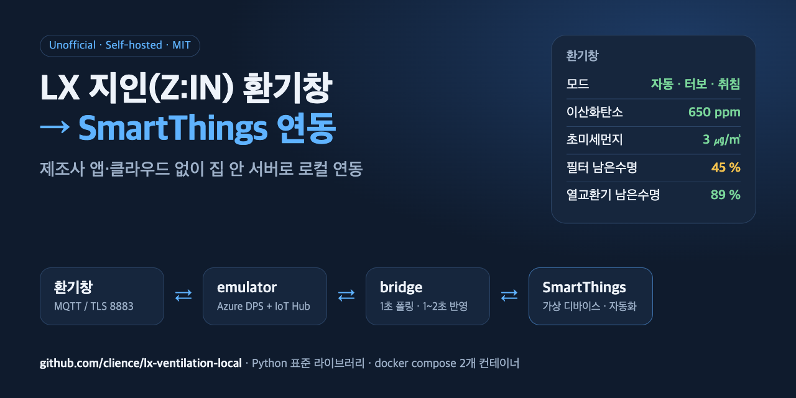

# lx-ventilation-local



**LX하우시스 지인(Z:IN) 스마트 환기창 · 스마트싱스(SmartThings) 연동 · 제조사 앱/클라우드 없이 집 안에서 로컬 제어**

**English summary.** Run an LX Z:IN "자동환기" window ventilator (model `LGH_SMARTVENTIL2021M_G1N`) without the
manufacturer's cloud. The device talks Azure IoT DPS → IoT Hub over MQTT/TLS and does not validate the server
certificate, so a tiny self-hosted DPS + IoT Hub emulator can take its place. A bridge mirrors telemetry to a
SmartThings virtual device and forwards power / fan / lamp / mode changes back within 1–2 seconds.
Python standard library only, two containers. Unofficial; use only on your own device.

---

LX Z:IN 자동환기 환기창(모델 `LGH_SMARTVENTIL2021M_G1N`)을 **제조사 클라우드 없이 집 안 서버로** 쓰기 위한
도구 모음입니다. 설치하면 SmartThings 앱에서 다음을 할 수 있습니다.

- 이산화탄소, 초미세먼지(PM2.5), 유해가스(TVOC), 온도·습도 실시간 확인
- 전원, 모드(자동/터보/취침), 풍량, 조명 조작 — 누르고 1~2초 안에 반영
- 필터·열교환기 남은수명(%) 확인
- SmartThings 자동화: "CO2가 1,000ppm을 넘으면 켜고 터보" 같은 규칙

## 목차

- [동작 구조](#동작-구조)
- [준비물](#준비물)
- [설치](#설치) — 0단계 호스트 이름부터 5단계 브리지 기동까지
- [사용법](#사용법) — 앱 화면, 자동화 예시, 상태 확인, 직접 명령
- [운영](#운영) — 업데이트, 재시작, 로그 정리
- [문제 해결](#문제-해결)
- [한계](#한계) · [원래대로 되돌리기](#원래대로-되돌리기) · [면책](#면책)

## 동작 구조

```
 ┌──────────────┐  MQTT/TLS :8883   ┌──────────────────────┐   data/raw.log   ┌──────────┐  REST  ┌─────────────┐
 │  환기창 (ESP) │ ────────────────▶ │ emulator             │ ───────────────▶ │  bridge  │ ─────▶ │ SmartThings │
 │              │ ◀──────────────── │ (DPS + IoT Hub 흉내)  │ ◀─────────────── │          │ ◀───── │ 가상 디바이스 │
 └──────────────┘  desired twin     └──────────────────────┘   data/cmd.json  └──────────┘ 1s 폴링 └─────────────┘
        ▲
        │ 최초 1회: 기기 AP(lxhsv_xxxxxx)에 붙어 Wi-Fi·dpsEndpoint 주입 (provisioning/provision.py)
```

1. 기기는 원래 Azure IoT DPS에 등록한 뒤 IoT Hub에 MQTT(TLS 8883)로 붙습니다. 서버 인증서를 검증하지 않으므로
   자체서명 인증서로 띄운 에뮬레이터가 DPS와 IoT Hub 역할을 모두 합니다.
2. 프로비저닝 때 `dpsEndpoint`를 내 호스트 이름으로 넣으면, 기기는 그 뒤로 내 서버에만 연결합니다.
3. 에뮬레이터는 기기가 보내는 모든 메시지를 `data/raw.log`에 남기고, `data/cmd.json`이 생기면 0.5초 안에
   desired twin PATCH로 기기에 전달합니다.
4. 브리지는 `raw.log`에서 최신 값을 읽어 10초마다 SmartThings에 올리고, SmartThings 상태를 1초마다 확인해
   사용자가 바꾼 값을 `cmd.json`에 씁니다.

| 경로 | 내용 |
|------|------|
| `emulator/dps_hub_emulator.py` | DPS + IoT Hub MQTT 에뮬레이터 |
| `emulator/gen-cert.sh` | 자체서명 인증서 생성 |
| `bridge/bridge.py` | 에뮬레이터 ↔ SmartThings 브리지 |
| `provisioning/provision.py` | 기기 AP 모드에서 Wi-Fi·DPS 설정 주입 |
| `smartthings/` | 디바이스 프로파일·화면 정의(device-config), 생성 스크립트 |
| `docs/protocol.md` | 기기 프로토콜 정리 (텔레메트리, 명령, 모드 코드, 공기질 기준) |
| `docs/smartthings-notes.md` | SmartThings 가상 디바이스 시행착오 |

## 준비물

- **항상 켜져 있는 서버 1대**: NAS, 라즈베리파이, 미니 PC 등. Docker + docker compose, 또는 Python 3.10 이상.
- **호스트 이름 1개**: 기기가 DNS로 해석해서 위 서버의 IP를 얻을 수 있어야 합니다. 기기는 IP 주소를 받지 않습니다.
  만드는 방법은 [0단계](#0-호스트-이름-준비)를 보세요.
- **2.4 GHz Wi-Fi**: 기기용. 서버와 같은 네트워크면 가장 간단합니다.
- **Wi-Fi가 되는 PC/노트북**: 최초 1회 프로비저닝 때 기기 AP에 붙어야 합니다.
- **SmartThings 계정 + [SmartThings CLI](https://github.com/SmartThingsCommunity/smartthings-cli)** (3.x에서 확인).

## 설치

전체 흐름은 다음과 같습니다. 단계마다 "확인" 항목이 통과한 뒤 다음으로 넘어가세요.

| 단계 | 할 일 | 소요 |
|------|-------|------|
| 0 | 호스트 이름 준비 | 5분 |
| 1 | 저장소 받기, 설정, 인증서 | 2분 |
| 2 | 에뮬레이터 기동 | 1분 |
| 3 | 기기 프로비저닝 | 5분 |
| 4 | SmartThings 가상 디바이스 만들기 | 3분 |
| 5 | 토큰 넣고 브리지 기동 | 3분 |

### 0. 호스트 이름 준비

기기가 `vent.example.com` 같은 이름을 서버 IP(예: `192.168.0.10`)로 풀 수 있게 만드는 단계입니다. 둘 중 하나를 고르세요.

- **공유기 로컬 DNS**: 공유기 설정에서 "DNS 레코드", "로컬 호스트 이름" 같은 메뉴에 이름과 서버 IP를 등록합니다.
  외부에 아무것도 공개하지 않아 가장 안전합니다. 공유기가 이 기능을 지원해야 합니다.
- **공인 DNS에 내부 IP 등록**: 가진 도메인의 DNS에 A 레코드로 `vent.example.com → 192.168.0.10`(내부 IP)을
  등록합니다. Cloudflare라면 프록시를 끄고 "DNS only"로 둡니다. 내부 IP라 외부에서 접속할 수는 없습니다.

확인:

```bash
nslookup vent.example.com    # 서버의 내부 IP가 나와야 합니다
```

### 1. 저장소 받기, 설정, 인증서

```bash
git clone https://github.com/clience/lx-ventilation-local.git
cd lx-ventilation-local
cp .env.example .env
```

`.env`를 열어 `EMU_HUB_HOST`를 0단계의 호스트 이름으로 바꿉니다. 나머지는 뒤 단계에서 채웁니다.

```bash
set -a; . ./.env; set +a
./emulator/gen-cert.sh        # data/cert.pem, data/key.pem 생성 (CN=EMU_HUB_HOST, 10년)
```

확인: `ls data/` 에 `cert.pem`, `key.pem`이 있습니다.

### 2. 에뮬레이터 기동

`ST_DEVICE_ID`는 4단계에서 채우므로 지금은 에뮬레이터만 올립니다.

```bash
docker compose up -d emulator
docker compose logs -f emulator
```

확인: 로그에 리슨 메시지가 나오고, 다른 PC에서 서버의 8883 포트가 열려 있습니다.

```bash
nc -vz vent.example.com 8883   # succeeded / open 이면 OK
```

### 3. 기기 프로비저닝

기기에 집 Wi-Fi 정보와 "내 서버로 붙어라"는 정보를 넣는 단계입니다. 기기를 바꾸거나 Wi-Fi를 바꿀 때만 다시 합니다.

1. 기기를 Wi-Fi 등록(페어링) 모드로 둡니다. 방법은 제조사 설명서의 Wi-Fi 등록 절차를 따르세요.
   기기가 `lxhsv_xxxxxx` 이름의 Wi-Fi를 엽니다.
2. PC를 그 Wi-Fi에 연결합니다. 비밀번호는 SSID의 `_` 뒤 문자열을 두 번 이어 붙인 값입니다
   (예: `lxhsv_ab12cd` → `ab12cdab12cd`). 앱 동작에서 확인한 규칙이라 펌웨어에 따라 다를 수 있습니다.
3. 먼저 `--dry-run`으로 보낼 내용을 확인한 뒤 실제로 보냅니다. 비밀번호는 출력에서 가려집니다.

```bash
export WIFI_PASSWORD='집 Wi-Fi 비밀번호'
python3 provisioning/provision.py --ssid '집Wi-Fi이름' --dps-endpoint "$EMU_HUB_HOST" --device-id lx-vent-1 --dry-run
python3 provisioning/provision.py --ssid '집Wi-Fi이름' --dps-endpoint "$EMU_HUB_HOST" --device-id lx-vent-1
```

4. PC를 원래 Wi-Fi로 되돌립니다.

확인: 수십 초 안에 에뮬레이터 로그에 아래 순서가 보이면 성공입니다.

```
[DPS] CONNECT ...
[HUB] CONNECT ...
[HUB] *** TELEMETRY *** {"sensor":{..."airCondition":{"co2":...}}}
```

> ⚠️ `provision.py`는 기기·앱 통신을 관찰해 재구성한 것으로, 공개 저장소 버전 자체는 아직 실기기에서 다시
> 검증하지 않았습니다. 실패하면 `--dry-run` 출력과 함께 이슈로 알려주세요.

### 4. SmartThings 가상 디바이스 만들기

```bash
smartthings login                           # 처음이면 브라우저 로그인
smartthings locations                       # locationId 확인
smartthings locations:rooms <locationId>    # roomId 확인 (선택)
./smartthings/setup.sh --location <locationId> --room <roomId> --name "환기창"
```

마지막에 출력되는 디바이스 id를 `.env`의 `ST_DEVICE_ID`에 넣습니다.

확인: SmartThings 앱의 기기 목록에 "환기창"이 생깁니다. 값은 브리지를 켜면 채워집니다.

> 디바이스를 만들면 SmartThings가 모든 값을 무작위 숫자로 한 번 채웁니다(예: CO2 600,000ppm). 이 값은 기록
> 그래프에 한 건 남고 지울 수 없습니다. 브리지가 켜지면 바로 실제 값으로 바뀝니다.

### 5. 토큰 넣고 브리지 기동

브리지는 SmartThings API에 접근할 토큰이 필요합니다. SmartThings의 신규 개인 액세스 토큰(PAT)은 24시간 뒤
만료되므로, CLI 로그인으로 받은 OAuth 토큰을 쓰고 만료되면 브리지가 알아서 갱신합니다.

1. CLI 자격 증명 파일(macOS/Linux: `~/.config/@smartthings/cli/credentials.json`)에서 값을 꺼내 저장합니다.

```bash
python3 - <<'PY'
import json, os
c = json.load(open(os.path.expanduser("~/.config/@smartthings/cli/credentials.json")))["default"]
open("data/st_token.txt", "w").write(c["accessToken"] + "\n")
open("data/st_refresh.txt", "w").write(c["refreshToken"] + "\n")
PY
chmod 600 data/st_*.txt
```

2. `.env`의 `ST_CLIENT_ID`는 그 토큰을 발급한 OAuth client id입니다. CLI 로그인 토큰이면 `.env.example`에 적힌
   SmartThings CLI 기본값을 그대로 두면 됩니다.
3. 브리지를 올립니다.

```bash
docker compose up -d
docker compose logs -f bridge
```

확인: 로그에 `pushed ... events`가 보이고, 앱의 "환기창"에 CO2 등 값이 채워집니다. 앱에서 조명을 켜 보면
로그에 `ST -> device {"lamp": {"style": "all"}}`가 찍히고 1~2초 안에 기기 조명이 켜집니다.

> ⚠️ **refresh 토큰은 한 번 쓰면 새 것으로 바뀝니다.** 브리지가 쓰는 토큰으로 CLI를 계속 쓰면 갱신 체인이
> 갈라져 한쪽이 로그아웃됩니다. 토큰을 넣은 뒤 CLI가 필요하면 `smartthings logout` 후 다시 로그인해
> 별도 세션으로 쓰세요.

## 사용법

### 앱 화면

기기 목록 타일은 전원 상태를 보여줍니다. 켜져 있으면 "켜짐", 꺼져 있으면 회색 "꺼짐"입니다.
타일을 누르면 아래 순서로 나옵니다.

| 항목 | 설명 | 조작 |
|------|------|------|
| 전원 | 켜기/끄기 | ✅ |
| 모드 | 자동(CO2 기반 자동 환기) / 터보 / 취침(저소음) | ✅ |
| 팬 속도 | 풍량 | ✅ |
| 조명 | 본체 조명 켜기/끄기 | ✅ |
| 초미세먼지 | PM2.5 ㎍/㎥, 그래프 0~150 | — |
| 온도·습도 | 기기 내부 센서 | — |
| 유해가스 (TVOC) | 기기 지수값(ppb 아님) | — |
| 이산화탄소 | ppm, 그래프 0~2,500 | — |
| 필터 교체 · 남은수명 | % | — |
| 소자 교체(열교환기) · 남은수명 | % | — |

- 모드·팬 속도·조명은 **전원이 켜져 있을 때만** 화면에 보입니다. SmartThings 앱의 동작입니다.
- 기기가 꺼져 있어도 공기질 값은 계속 갱신됩니다. 팬이 멈춰 있으니 CO2가 오르는 게 정상입니다.
- 공기질 판단 기준은 [docs/protocol.md](docs/protocol.md#공기질-등급)를 보세요. CO2는 1,000ppm 이하를 권장합니다.

### 자동화 예시

SmartThings 앱 → 자동화 → 추가에서 "환기창"을 조건이나 동작으로 고르면 됩니다.

| 목적 | 조건 | 동작 |
|------|------|------|
| CO2가 높으면 강하게 환기 | 이산화탄소 ≥ 1,000 ppm | 전원 켜기, 모드 터보 |
| 공기가 좋아지면 자동으로 | 이산화탄소 ≤ 700 ppm (모드가 터보일 때) | 모드 자동 |
| 잘 때 조용히 | 매일 23:00 | 모드 취침, 조명 끄기 |
| 외출 시 끄기 | 모든 구성원 외출 | 전원 끄기 |
| 필터 교체 알림 | 필터 남은수명 ≤ 10 % | 알림 보내기 |

### 상태 확인

```bash
docker compose ps                                   # 두 컨테이너가 running 인지
docker compose logs --tail 20 bridge                # 마지막 push / 사용자 명령
docker compose logs --tail 20 emulator              # 기기 접속·명령 전달
tail -n 3 data/raw.log                              # 기기가 보낸 마지막 원본 메시지
```

### 앱 없이 직접 명령 보내기

`data/cmd.json`에 desired 값을 쓰면 0.5초 안에 기기로 전달되고 파일은 지워집니다. 형식은
[docs/protocol.md](docs/protocol.md)에 있습니다.

```bash
echo '{"desired":{"sensor":{"power":{"status":"on"}}}}'   > data/cmd.json   # 켜기
echo '{"desired":{"sensor":{"mode":"3"}}}'                > data/cmd.json   # 터보 (2 자동, 3 터보, 4 취침)
echo '{"desired":{"sensor":{"lamp":{"style":"none"}}}}'   > data/cmd.json   # 조명 끄기
echo '{"desired":{"sensor":{"timer":{"status":"on","hour":2}}}}' > data/cmd.json   # 2시간 타이머 (앱에는 없음)
```

전원·모드·풍량·조명은 실기기에서 확인했습니다. 타이머 형식은 제조사 앱 동작을 분석한 결과로, 실기기 검증 전입니다.

## 운영

### 업데이트

```bash
git pull
docker compose up -d --force-recreate bridge     # 브리지만 바뀌었으면 이것만. 기기 연결은 끊기지 않습니다.
docker compose up -d --force-recreate emulator   # 에뮬레이터가 바뀌었을 때만. 기기가 약 40초 뒤 다시 붙습니다.
```

### SmartThings 화면을 바꾸고 싶을 때

`smartthings/device-config.json`(라벨·순서·그래프 범위)을 고친 뒤 `setup.sh`를 다시 돌려 **새 디바이스**를 만들어야
합니다. SmartThings는 가상 디바이스의 화면 정의를 생성 시점에 고정합니다. 새 id를 `.env`에 넣고
`docker compose up -d --force-recreate bridge` 한 뒤, 예전 디바이스를 쓰던 자동화를 옮기고 지우세요.
시행착오는 [docs/smartthings-notes.md](docs/smartthings-notes.md)에 정리했습니다.

### 로그 정리

`data/raw.log`는 계속 커집니다. 브리지는 끝부분만 읽으므로 동작에는 문제없지만, 가끔 비워도 됩니다.

```bash
: > data/raw.log
```

## 문제 해결

| 증상 | 확인할 것 |
|------|-----------|
| 에뮬레이터 로그에 `CONNECT`가 안 나옴 | 기기가 호스트 이름을 서버 IP로 푸는지(0단계), 8883 포트가 열렸는지(2단계), 기기가 2.4 GHz Wi-Fi에 붙었는지. 프로비저닝을 다시 해보세요. |
| `TLS rejected` 로그 | 다른 장비가 8883으로 붙은 경우가 많습니다. 기기 IP에서 온 것인지 확인하세요. |
| 앱에 값이 안 채워짐 | `ST_DEVICE_ID`가 맞는지, 브리지 로그에 `API ... -> 4xx`가 있는지 확인하세요. |
| 브리지 로그에 `refresh FAILED` | refresh 토큰이 이미 쓰였거나 client id가 다릅니다. CLI로 다시 로그인해 5단계를 반복하세요. |
| 브리지 로그에 `422` | 디바이스 프로파일에 없는 능력으로 이벤트를 보낸 것입니다. `setup.sh`로 만든 디바이스인지 확인하세요. |
| 앱에서 눌러도 반응이 늦음 | 브리지 로그에 `ST -> device`가 바로 찍히는지 보세요. 찍히는데 기기가 늦으면 에뮬레이터 로그의 `pushed desired`를 확인하세요. |
| 온도가 °F처럼 이상하게 보임 | 브리지가 시작할 때 온도 범위를 ℃로 덮어씁니다. 브리지가 한 번이라도 돌았는지 확인하세요. |
| 모드·조명이 안 보임 | 전원이 꺼져 있으면 앱이 조작 항목을 숨깁니다. 켜고 다시 보세요. |
| 앱에 "기기에 연결할 수 없음" | device-config를 직접 고쳤다면 앱이 못 그리는 구성일 수 있습니다. 원본으로 다시 만들어 보세요. |

## 한계

- 기기 1대 기준입니다(가상 디바이스 1개). 여러 대는 디렉터리를 나눠 compose를 따로 띄우는 것을 권합니다.
- 에뮬레이터는 이 기기에 필요한 만큼만 MQTT를 구현했습니다(QoS 0 전달, retained 없음, 인증 없음).
  **8883 포트를 인터넷에 열지 마세요.** 누구나 붙을 수 있습니다.
- SmartThings 앱의 모드 선택지는 자동/터보/취침 세 가지입니다. 강제배기(1), 풍량 수동(5), 급기(6)는
  넣지 않았습니다. 기기가 그 모드에 있으면 앱에는 직전 모드가 보입니다.
- 타이머는 앱에 없고 직접 명령으로만 가능합니다. 펌웨어 업데이트, 제조사 앱의 사용 이력·통계는 없습니다.
- 앱 기기 목록 타일은 전원 상태만 보여줍니다. SmartThings는 가상 디바이스 타일 문구를 바꿀 수 없게 막아 둡니다.

## 원래대로 되돌리기

제조사 앱에서 기기를 다시 등록하면 앱이 제조사 서버 정보로 프로비저닝을 다시 하므로 원래 상태로 돌아갑니다.
이 저장소는 기기 펌웨어를 바꾸지 않습니다. 이후 `docker compose down`으로 컨테이너를 내리고, SmartThings 앱에서
가상 디바이스를 삭제하면 됩니다.

## 면책

- 이 프로젝트는 비공식이며 LX하우시스, 삼성전자(SmartThings), Microsoft(Azure)와 아무 관계가 없고 그들의
  승인이나 지원을 받지 않았습니다. 언급한 상표는 각 소유자의 것입니다.
- 본인이 소유한 기기에만 사용하세요. 사용으로 인한 기기 이상, 보증 문제, 데이터 손실 등은 사용자 책임입니다.
- 프로토콜 정보는 상호운용 목적으로 기기와 앱의 통신을 관찰해 정리한 것이며, 제조사 코드나 펌웨어를 포함하지
  않습니다.
- 소프트웨어는 MIT 라이선스에 따라 "있는 그대로" 제공되며 어떤 보증도 하지 않습니다.

## 개발

```bash
python3 -m unittest discover -s tests -v
```

이슈와 PR 환영합니다. 다른 LX Z:IN 기종에서 동작했다면 모델명과 함께 알려주세요.

## 라이선스

[MIT](LICENSE)
